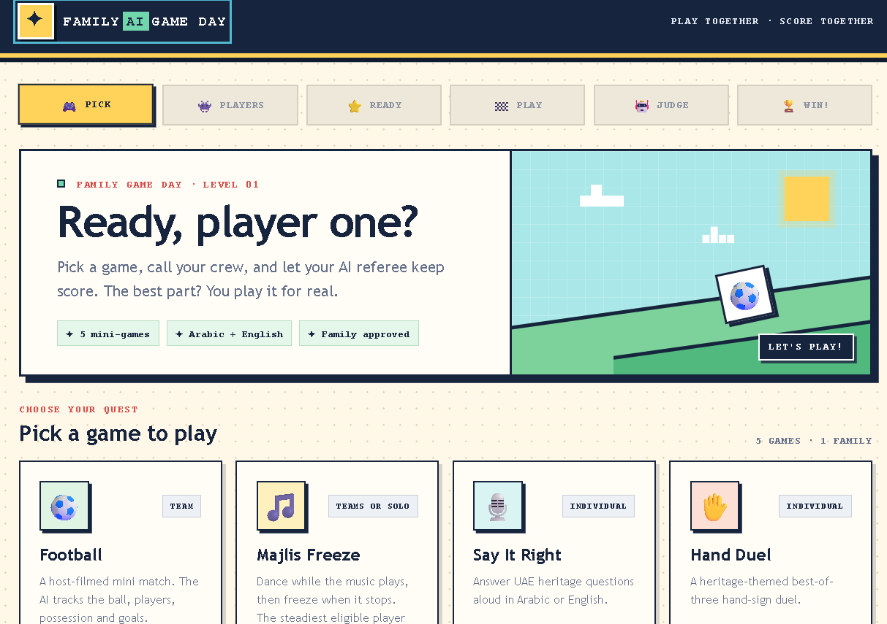
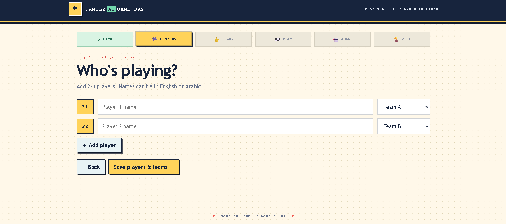
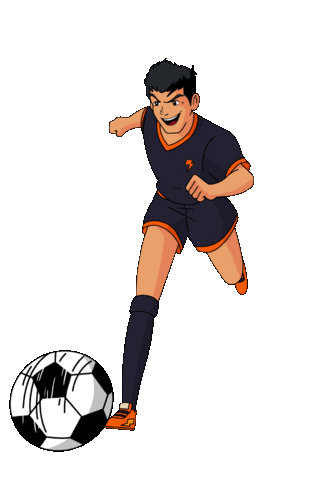

# 🎮 Family AI Game Day

### Pick a game. Play for real. Let the AI keep score. 🏆

Family AI Game Day is a local web app for five family-friendly mini-games. Set up players, record a round (or choose a video), review the AI judge's call, and apply the score.

> **School-project prototype:** the judge is a fun demo, not an official referee. Results depend on the clip, lighting, camera angle, and how clearly the ball or hands appear.

## ✨ A peek at the game

| Choose your challenge | Add your players |
|:--:|:--:|
|  |  |

| Football game-day animation | Music and freeze animation |
|:--:|:--:|
|  |  |

*The GIFs are decorative illustrations; they are not gameplay recordings.*

## 🕹️ The five games

| Game | What the judge looks at |
|---|---|
| ⚽ **Football** | People, the ball, marked goal areas, and estimated possession |
| 🎵 **Majlis Freeze** | Player pose movement after the music stops |
| 🎙️ **Say It Right** | A spoken Arabic or English answer to a UAE heritage question |
| ✋ **Hand Duel** | Falcon, Dhow, and Dallah hand signs |
| 🪣 **Bean-Bag Bucket Toss** | A colour-sampled bean bag and the marked bucket area |

## 🚀 Start playing (Windows)

### 1. Install Python

Install **Python 3.10 or newer**. During setup, enable **Add Python to PATH**.

### 2. Open this folder in PowerShell

In File Explorer, open the project folder, click the address bar, type `powershell`, and press Enter.

### 3. Install the app packages

Run this once:

```powershell
python -m pip install -r requirements.txt
```

### 4. Start the game

```powershell
python run.py
```

Leave that PowerShell window open, then visit **[http://localhost:8000](http://localhost:8000)** in your browser.

To shut the game down, return to PowerShell and press **Ctrl+C**. If the app says port 8000 is already in use, close the other running copy first.

## 🏁 Play a round

1. Choose a game and enter player names. Split players into teams when you want a team match.
2. Read the rules and press **Everyone ready**.
3. Record with your camera and microphone, or choose a saved video.
4. On the judge screen, mark the goals or bucket and tap the players or object if the game asks you to.
5. Press **Run AI judge**. Review the event explanations and annotated clip.
6. Press **Apply AI results** to verify the signed report and add its points to the score.

### 📹 Football clip tips

- Keep the camera steady at the side of the play area.
- Keep both players, the ball, and the goals in the frame.
- Use noticeably different shirt colours and good lighting.
- Draw the goal areas carefully and tap each player's starting position.
- Try a short clip first; a clear 20–30 second recording is easier to inspect.

MP4 and WebM clips are recommended. The upload limit is 300 MB. Your browser may ask permission to use the camera and microphone; recording on `localhost` is supported by modern browsers.

## 🤖 First-time AI setup

The AI model files download automatically the first time a game needs them. Keep the computer connected to the internet for that initial download; the models are then used locally. The first judge run can take longer while the models load.

For best compatibility, use a 64-bit Python installation. The app includes a packaged FFmpeg fallback for audio extraction and annotated video.

## 🔐 Signed reports

The server signs judge reports with a local secret before allowing their score changes. You can paste a standalone report on the judge screen to verify it. Changing a report after it was signed should make verification fail.

Keep `.env` private. It contains the local report-signing secret and should not be shared or included in a public export. `.env.example` is a safe setup template.

## 📁 Project guide

- `run.py` — starts the local web app.
- `server/` — game/session APIs and report signing.
- `judge/` — video, pose, hand, and audio judging logic.
- `frontend/` — the browser screens and styles.
- `screenshots/` — the screenshots and decorative GIFs shown above.
- `uploads/` and `outputs/` — temporary incoming clips and generated annotated clips.
- [Technical report (PDF)](TECHNICAL_REPORT.pdf) — implementation details and current limitations.

## 🧩 If something goes wrong

- **Page won't open:** check the PowerShell window for errors and confirm the app is running.
- **Port 8000 is busy:** stop another copy of `python run.py` with **Ctrl+C**.
- **Camera won't start:** allow camera/microphone permission, or use a saved clip instead.
- **Judge takes a while:** the first run may download or load a model.
- **No ball or hand detected:** move the camera closer, improve the light, and keep the object visible.
- **Need to start over?** Stop the server with **Ctrl+C**, then run `python run.py` again.

Have fun, cheer loudly, and may the best teammate win! 🍿
